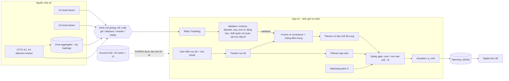

# 03 · Kiến trúc hệ thống và ADR (T3)

Trạng thái: **DRAFT chờ duyệt**. Không có bằng chứng trong registry so sánh trực tiếp ba topology; mọi đánh giá bên dưới là **HYPOTHESIS** cần thí nghiệm EX-ARCH (tài liệu 04) trước khi coi là kết luận.

## 1. Sơ đồ logic: đường an toàn tách khỏi đường tư vấn
**Bất biến vòng kín (Amendment A1):** `Physics → Perception → Communication → Fusion → Planning → Control → Physics`. Backend vật lý có thẩm quyền; frontend chỉ tiêu thụ trạng thái (I10, I11, I12). Chi tiết thứ tự bước ở 07 §1.

Phiên bản văn bản:
```
 [A2,A3 tracker]--\                                  +------------------ EGO A1 (ranh giới an toàn) -------------------+
 [K1..K4 tracker]--+--> KÊNH (trễ/mất/blackout/...) -> RX -> VALIDATOR -> FUSION -> PLANNER(có hạn chế) --\              |
 [aggregator?]----/                                  |  local sensor -> local tracker -> PLANNER(ego-only) ---> SAFETY   |
                                                     |  watchdog kênh ----------------------------------------> GATE ->a|
                                                     +------------------------------------------------------------------+
 Ground truth ---> (metric, UI)   x--> AV (I9)             a ---> telemetry JSONL ---> Digital twin 3D
```
Điểm kiến trúc then chốt: **GATE nhận lệnh từ planner ego-only không đi qua kênh**. Dữ liệu chia sẻ chỉ có thể làm GATE hạn chế thêm (I2). Đây là cấu trúc làm cho I1 kiểm được bằng test chứ không bằng lời hứa.

## 2. Ba topology để so sánh
| | Centralized (CEN) | Decentralized (DEC) | Hybrid (HYB) |
|---|---|---|---|
| Mô tả | Mọi nguồn gửi track lên máy chủ vùng; máy chủ hợp nhất và phát lại **world model hợp nhất** | Mỗi nguồn phát track của mình; mỗi xe tự hợp nhất những gì nhận được. CCTV/RSU chỉ chuyển tiếp | Aggregator ở rìa hợp nhất **các nguồn hạ tầng** (K1–K4) thành danh sách track hạ tầng; xe–xe vẫn trao đổi trực tiếp; mỗi xe vẫn hợp nhất cục bộ |
| Gợi ý từ bằng chứng | Có khái niệm "central ITS-S" (S01b:347~central ITS-S); pilot TP.HCM có trung tâm vận hành (C58·HCMC QTSC) — **không** nói về fusion tập trung | Chuẩn mô tả phát/nhận thông điệp object (C34·ETSI TS 103 324 ; C41·SAE J3224) | Demo FHWA: camera hạ tầng → RSU → V2X Hub → SDSM → xe (C45·FHWA CDA) |
| Giới hạn bằng chứng | Không có nguồn nào đánh giá | Không có nguồn nào đánh giá | Một demo, không so sánh |

## 3. So sánh theo tiêu chí (HYPOTHESIS, kèm cách kiểm)
Thang: Thấp / Vừa / Cao là **tương đối giữa ba phương án**, suy luận kỹ thuật `[ENG]`, không phải số đo.
| Tiêu chí | CEN | DEC | HYB | Cơ sở lập luận | Đo bằng |
|---|---|---|---|---|---|
| Trễ tới ego (cảnh báo CCTV) | Cao (thêm bước lên–xử lý–xuống) | Thấp (1 chặng) nhưng ego phải tự liên kết | Thấp–Vừa (1 chặng + tổng hợp ở rìa) | Số chặng | Phân rã trễ từng chặng, AoI tại ego |
| Băng thông | Vừa: uplink mọi nguồn, downlink đã khử trùng | Cao: mỗi xe nhận trùng nhiều nguồn; cần lọc VoI (S01b:933~should be omitted) | Vừa: hạ tầng khử trùng ở rìa, V2V vẫn trùng | Trùng lặp là vấn đề được ghi nhận (C29·CPS redundancy ; C30·CPS redundancy) | Byte/s theo link, số object trùng |
| Khả năng mở rộng | Điểm nghẽn/SPOF theo vùng | Tải nhận tăng theo số hàng xóm | Mở rộng theo vùng aggregator | Cấu trúc | Quét số nguồn (ngoài MVP; chỉ ghi nhận) |
| Quyền riêng tư | Tập trung dữ liệu track ở một nơi (dễ kiểm soát truy cập, cũng là mục tiêu tấn công) | Track của người đi bộ phát rộng trong tầm | Phát rộng V2V; hạ tầng tập trung ở rìa | Phụ thuộc cách xử lý pháp lý (G08 UNKNOWN) | Không đo được bằng sim; cần rà soát pháp lý |
| Độ bền | Thấp: mất server/backhaul mất tất cả góc nhìn chia sẻ | Cao: không SPOF, nhưng tầm nhìn tuỳ ai ở gần | Vừa–Cao: mất aggregator → CCTV phải **tự phát** (degradation có thiết kế) | Cấu trúc | E4c (blackout), FM07 |
| Độc lập quyết định an toàn của xe | Dễ bị cám dỗ tin world model server → cần rào kiến trúc | Cao (xe tự hợp nhất, tự quyết) | Cao nếu xe không phụ thuộc aggregator (I1) | Kiến trúc GATE ở §1 áp dụng cho cả ba | AC-M13, AC-M15 |
| Rủi ro đếm trùng/tương quan | Thấp ở xe nếu dùng world model duy nhất | Cao (hợp nhất track chồng nguồn) | Vừa–Cao (xe nhận cả aggregator lẫn peer, nguồn gốc chồng nhau) | Giả định C04 (HYPOTHESIS) | NEES, ID-switch, EX-ASSOC |
| Độ phức tạp xây dựng | Vừa | Vừa (liên kết ở mỗi xe) | Cao (thêm thành phần) | Số thành phần | Ước lượng WP |

## 4. Khuyến nghị (tạm thời, có điều kiện)
**Đề xuất: Hybrid với quyền quyết định an toàn hoàn toàn cục bộ (HYB-L), trạng thái PROPOSED — tạm thời.**
Lý do: (1) giữ I1 độc lập với hạ tầng; (2) khử trùng các nguồn hạ tầng chỉ có ở một nơi; (3) có tiền lệ cấu trúc (C45·FHWA CDA).
**Đánh đổi chấp nhận:** thêm một thành phần phải xây và kiểm thử; thêm một chặng trễ cho cảnh báo CCTV so với DEC; nguy cơ đếm trùng khi xe nhận cả bản aggregator lẫn bản peer.
**Giảm thiểu:** (a) mỗi track hợp nhất mang `from[]` (dòng dõi nguồn) và xe không hợp nhất hai lần cùng nguồn gốc; (b) dùng phương pháp an toàn với tương quan chưa biết làm phương án dự phòng (C04, HYPOTHESIS); (c) khi aggregator hỏng, mỗi CCTV tự phát (hạ về DEC).
**Điều kiện đổi quyết định (đặt trước khi chạy):**
- Nếu EX-ARCH cho thấy DEC không kém HYB về va chạm/phanh nhầm/near-miss **và** độ trễ cảnh báo thấp hơn → chọn DEC (đơn giản hơn).
- Nếu ID-switch ở DEC vượt ngưỡng do chủ việc đặt (04 §6) → nghiêng về HYB/CEN.
- Nếu HYB làm mất cảnh báo ở vùng trễ nhạy (E4a) mà DEC không mất → bác HYB.
- CEN chỉ giữ lại làm đường cơ sở so sánh, trừ khi bằng chứng mới thay đổi.
**Không thừa nhận người thắng:** cả ba chạy qua cùng giao diện (R-FUS-02) và cùng bộ test; ADR-002 chỉ chuyển sang ACCEPTED sau EX-ARCH và duyệt của chủ việc.

## 5. Bản ghi quyết định kiến trúc (ADR-001…ADR-009)
### ADR-001 · Mức độ chia sẻ: track mức object — ACCEPTED (chủ việc quyết)
Bối cảnh: chuẩn mô tả danh sách object (C34·ETSI TS 103 324 ; C41·SAE J3224). Quyết định: chia sẻ track có pose, vận tốc, lớp, bất định, thời gian, provenance (`TrackMsg`, 02 §8). Hệ quả: băng thông thấp, ít nhạy cảm riêng tư, có thể gỡ lỗi; mất khả năng fuse đặc trưng (không thuộc MVP). Rủi ro: lỗi pose gây lệch toàn bộ (A01 VERIFIED, A03 HYPOTHESIS).

### ADR-002 · Topology fusion — PROPOSED (xem §4)
Lựa chọn: CEN / DEC / HYB. Đề xuất tạm: HYB-L. Điều kiện đổi và thí nghiệm: §4, EX-ARCH.

### ADR-003 · Thẩm quyền an toàn: cục bộ bắt buộc, chia sẻ chỉ tư vấn — ACCEPTED (chủ việc quyết)
Quyết định: bất biến I1–I9 (02 §6); GATE lấy `min` hạn chế. Hệ quả: an toàn không phụ thuộc kênh (đạt), nhưng chi phí là phanh nhầm khi chia sẻ sai (đo, không giấu); không thể dùng chia sẻ để *nới* tốc độ. Phương án nới có điều kiện bị hoãn tới khi có bằng chứng (D03, F03 hiện UNKNOWN). **Lưu ý (DEC-1):** với tính toán ở 04 §3, ego-only thận trọng đã tránh được va chạm S01 với chi phí ≈1 s; nên theo ADR-003 lợi ích an toàn của chia sẻ so với baseline đó bằng 0 theo thiết kế. ADR-003 vì vậy chỉ ACCEPTED ở mức nguyên tắc; cách lượng hoá giá trị (P1/P2) chờ chủ việc.

### ADR-004 · Cơ sở thời gian và độ tươi — PROPOSED
Quyết định: đồng hồ mô phỏng toàn cục + mô hình đồng hồ từng nút (offset, drift); thông điệp mang `t_meas`, `t_sent` theo đồng hồ nguồn; bên nhận tính tuổi và **không giả định offset=0**. Hai loại AoI được ghi: AoI thật (từ mô phỏng) và AoI ước lượng (bên nhận thấy); chênh lệch là chỉ số quan sát. Cơ sở: B01 VERIFIED; B03 SUPPORTED; B04, B06 UNKNOWN.

### ADR-005 · Backend mô phỏng vật lý — PROPOSED (sửa bởi Amendment A1)
Lựa chọn: (a) backend vật lý nhẹ tự viết, tất định, bước cố định; (b) CARLA + OpenCDA (có framework co-sim, C26·OpenCDA); (c) ROS 2/Gazebo. Đề xuất: **(a) làm mặc định**, với xe đạp động học + vòng ma sát + actuator trễ/jerk + va chạm OBB/capsule + cảm biến 2.5D (07 §2–§4), được xác thực bằng bài giải tích (PHY-01..08). **(b) là đích tích hợp tương lai** qua giao diện `PhysicsBackend`/`SensorProvider` (07 §9); cổng đối chiếu chéo PX-1 chưa làm. **Không tuyên bố backend nhẹ có độ trung thực tương đương CARLA.** Rủi ro: độ trung thực thấp (V02..V06 trong ma trận), kết quả chỉ có giá trị trong mô hình. Chưa có nguồn so sánh các bộ sim.

### ADR-006 · Truyền trạng thái có thẩm quyền và frontend — PROPOSED (sửa bởi Amendment A1)
Quyết định: backend chạy bước cố định và **phát trạng thái có thẩm quyền** (25–50 Hz, mang `t_sim`) qua WebSocket (live) hoặc ghi JSONL (replay); frontend nội suy theo `t_sim` **chỉ để vẽ**, mọi số hiển thị lấy từ khung có thẩm quyền. UI không có đường điều khiển vào vật lý (I12). Hệ quả: cần backend dịch vụ (FastAPI/uvicorn/websockets) — **thay thế** quyết định cũ "replay tĩnh không backend". Kết quả khoa học tách khỏi FPS (I11, VIS-10). Công nghệ render xem ADR-009.

### ADR-007 · Riêng tư: chỉ object — PROPOSED, có cổng pháp lý
Quyết định: không ảnh/biometric qua ranh giới nguồn (N-06, `privacy_level=object_only`). Cơ sở pháp lý hiện có chỉ tier B (C77·Luật BVDLCN ; C79·Luật BVDLCN ; C83·Nghị định 356). Việc track người đi bộ có phải dữ liệu cá nhân hay không là G08 **UNKNOWN**. Cổng: rà soát pháp lý trước bất kỳ triển khai thực địa nào; MVP mô phỏng không bị chặn.

### ADR-008 · Giao diện PhysicsBackend và đường tích hợp CARLA — PROPOSED
Quyết định: cắt đường nối ở biên vật lý + cảm biến (`PhysicsBackend`, `SensorProvider`; 07 §9); phần Perception→Control không biết backend nào đang chạy; mọi kết quả ghi `backend.metadata`. Hệ quả: có thể thêm CarlaBackend sau mà không viết lại; **lớp dịch điều khiển và hệ toạ độ là rủi ro chưa xác thực**. Không nguồn nào trong registry đánh giá độ trung thực hay tính tất định của CARLA trong bối cảnh này (UNKNOWN).

### ADR-009 · Công nghệ trực quan hoá và quản lý tài sản — PROPOSED
Quyết định đề xuất: **React Three Fiber + drei + Three.js**, vòng render đọc trạng thái qua `ref`/store ngoài React (không `setState` mỗi khung), instancing cho cây/toà nhà/đèn, tài sản dựng thủ tục trước; mọi tài sản ngoài có bản ghi nguồn + giấy phép (`web/ASSETS.md`). Lựa chọn thay thế (Three.js thuần, Babylon, deck.gl/Cesium) và lý do ở 07 §10.1. Hệ quả: thêm chuỗi build (Vite) và phụ thuộc cần duyệt trước khi cài; phương án dự phòng là Three.js thuần nếu R3F không đạt VIS-07.

## 6. Câu hỏi mở của kiến trúc
1. Quy tắc nhận/xử lý CPM/SDSM (chưa đọc) có thể buộc kiến trúc bên nhận khác với giả định G01.
2. Cơ chế xác thực thông điệp trong mô hình (E05/E06): MVP chỉ có allowlist+seq; chưa có PKI thật.
3. Tương tác với lớp điều khiển thấp (STM32/CAN) nằm ngoài MVP.
